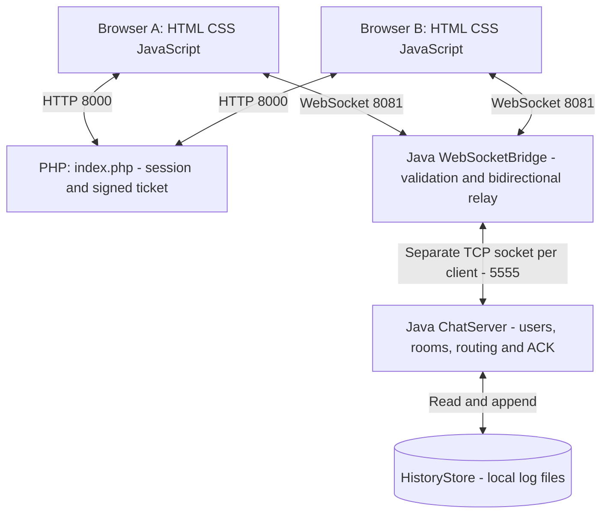
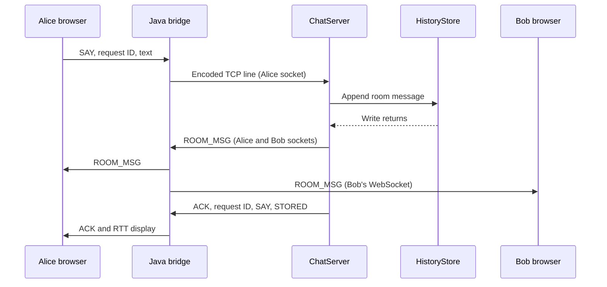
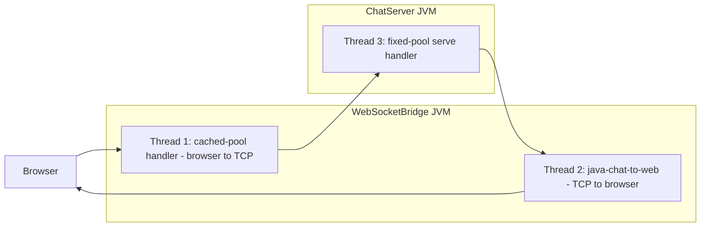
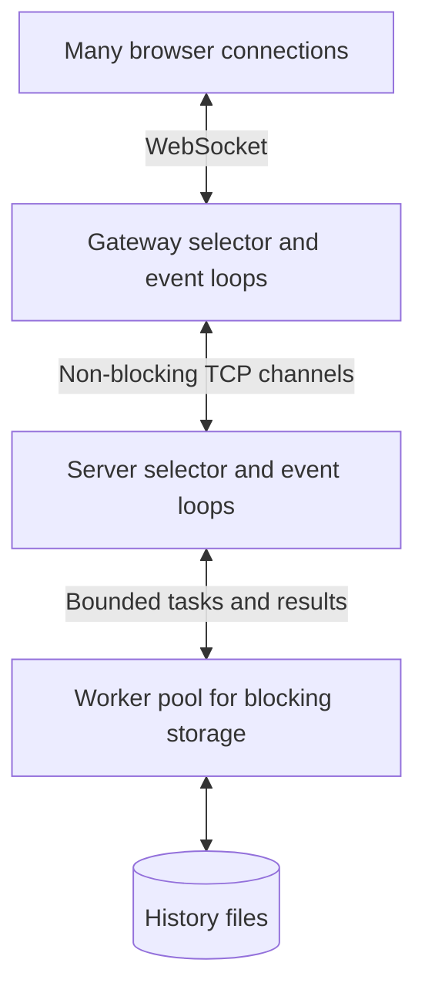

# Enhanced Java Chat System

A **web-based, multi-user chat system** built with **Java, PHP, HTML, CSS, and JavaScript**. Users interact exclusively through a browser; there are **no Java Swing components and no desktop client required**.

## Features

- Multiple simultaneous users on one Java TCP server
- Chat rooms, room-isolated messages, private messages, and online-user list
- Saved room/DM history, reconnections, server acknowledgments and timing
- Browser chat interface built with HTML, CSS and JavaScript
- PHP session-based username selection and short-lived signed connection tickets
- Java WebSocket bridge that forwards browser messages to the existing Java TCP server
- Java integration tests for protocol handling, validation, concurrency, and failures

## Requirements

- **JDK 17+** (`java -version` and `javac -version`)
- **PHP 8+** (`php -v`); install PHP or use the PHP binary supplied with a suitable local setup
- A modern browser (Chrome, Edge, Firefox)
- Windows PowerShell for the commands below (or equivalent shell on other systems)
- No Swing, JavaFX, npm, Composer, or external Java libraries

## Download

Download and extract the Web Edition ZIP, then open PowerShell **in the extracted folder** (the folder containing `src` and `web`). Classmates can also download the latest browser-only repository using **Code → Download ZIP** on GitHub, or clone the repository using its HTTPS URL. Confirm that `src`, `web`, and `scalability_test.py` are present before testing. Extract the ZIP before compiling.

## Start on Windows (three PowerShell terminals)

Open PowerShell in the project folder. Stop any old copies of the three services first (Ctrl+C in their own terminals). Run the following block in one window; the two new PowerShell processes inherit the same randomly generated secret. The PHP server runs in the original window. No manual secret copying is required.

```powershell
New-Item -ItemType Directory -Force out | Out-Null
javac -encoding UTF-8 -d out (Get-ChildItem .\src\*.java).FullName
if ($LASTEXITCODE -ne 0) { throw 'Compilation failed' }
$php = (Get-Command php -CommandType Application -ErrorAction Stop).Source
$bytes = New-Object byte[] 32
$rng = [System.Security.Cryptography.RandomNumberGenerator]::Create()
$rng.GetBytes($bytes)
$rng.Dispose()
$env:CHAT_WEB_SECRET = [Convert]::ToBase64String($bytes)
Start-Process powershell.exe -WorkingDirectory (Get-Location).Path -ArgumentList '-NoExit','-Command','java -cp out ChatServer'
Start-Process powershell.exe -WorkingDirectory (Get-Location).Path -ArgumentList '-NoExit','-Command','java -cp out WebSocketBridge'
& $php -S 127.0.0.1:8000 -t web
```

The default ports are TCP 5555, WebSocket 8081 and HTTP 8000. Wait for both Java services to report that they are listening before opening the website. If PHP is not on PATH, replace the `$php = ...` line with the full path to your installed PHP executable. Never commit the secret or stored conversations.

Open **http://127.0.0.1:8000** in your browser. Use that exact host (not `localhost`) because the WebSocket bridge checks the browser's origin. Choose a username to enter chat.

**Test multiple users on one computer:** Open a normal browser window as `Alice` and an Incognito/InPrivate window as `Bob`. For a third user, open a separate browser profile or a different browser as `Charlie`. Multiple tabs in one browser profile usually share the same PHP session/username.

## How to use the website

1. Choose a unique username when the site opens.
2. Click the `+` button next to **Rooms** to join or create a room, such as `project`.
3. Send messages with the message field and **Send** button.
4. Click a user under **Online users** to start a private conversation.
5. Click **Room chat** to return to the shared room.
6. Click **Load history** to view earlier messages.
7. Observe server acknowledgments and response timing when sending messages.
8. Use **Leave account** to exit the current browser session.

## How classmates can test independently

Every classmate can extract the same project and start all three services **on their own computer**. They can open two or three separate browser sessions to test the full application without connecting to your PC.

For **shared local testing**, the PHP and the WebSocket bridge are intentionally limited to `127.0.0.1` (the TCP server binds all interfaces by default; keep port 5555 firewalled) and is **not accessible from other computers**. To run one shared remote website, you must first implement and deploy HTTPS, WSS, real accounts and authorization, a production PHP server, and a secure reverse proxy. **Do not open ports 5555, 8081, or 8000 directly to the internet.**

## Run the automated tests

After compiling, open a fourth terminal in the same folder:

```powershell
java -cp out ChatIntegrationTest
```

The test suite starts a temporary Java chat server on a separate port; it does not need the manually started server. In the previously prepared edition, the suite was designed to produce `PASS: 36 integration assertions.`; verify the actual result on your machine rather than assuming it passed.

### Suggested class demo checklist

- [ ] Connect Alice, Bob, and Charlie from separate browser sessions
- [ ] Show usernames cannot be duplicated while connected
- [ ] Create a `project` room; verify lobby users do not get its messages
- [ ] Send a private message
- [ ] Refresh/reconnect, and load previous history
- [ ] Send messages from two users simultaneously
- [ ] Disconnect a client and show the server remains running
- [ ] Explain TCP newline framing, Base64 fields, multithreading, WebSocket bridge, and acknowledgments
- [ ] Run integration tests and record real results

## System architecture

The browser-only application separates the presentation layer, HTTP session handling, real-time gateway, TCP messaging service and persistent storage. PHP is not in the live-message relay path. The browser uses HTTP for page loading and username selection, then opens a separate persistent WebSocket to Java. Each accepted browser session has its own backend TCP connection.



| Component        | Implementation and responsibility                                                                                                                                                          |
| ---------------- | ------------------------------------------------------------------------------------------------------------------------------------------------------------------------------------------ |
| Browser          | `web/assets/chat.js` opens the WebSocket, encodes commands, displays events and tracks acknowledgment RTT. HTML and CSS provide the interface.                                             |
| PHP              | `web/index.php` validates usernames, maintains the PHP session and signs a username/timestamp ticket using HMAC-SHA256.                                                                    |
| WebSocket bridge | `src/WebSocketBridge.java` validates the HTTP upgrade, exact origin and ticket (within a 300-second clock window), connects to the TCP server and relays in both directions.               |
| TCP server       | `src/ChatServer.java` accepts connections, validates commands, manages shared room/user state, routes messages and logs failures.                                                          |
| Protocol         | `src/Protocol.java` encodes UTF-8 fields separately in Base64, separated by TAB. TCP frames end with LF (CRLF accepted). WebSocket text frames carry the encoded line without the newline. |
| Storage          | `src/HistoryStore.java` synchronizes file reads and appends. Room and private histories use separate log files; no database is required.                                                   |

### Message flow



The server validates the message (up to 2,000 Java string characters) and enforces a 16,384-byte inbound TCP frame limit. The bridge limits WebSocket payloads to 16,384 bytes and supports unfragmented text frames. TCP segmentation is independent of WebSocket fragmentation: the TCP reader assembles bytes until a newline, so split or combined TCP writes are handled. The ACK follows storage and attempted routing; it is not proof of recipient display or disk fsync durability. Private messages follow the same pattern but target a named online user. Disconnections close sockets and remove registered users from shared state.

## Concurrency design: three threads per active web client



The bridge accepts a WebSocket and submits `handle(peer)` to `Executors.newCachedThreadPool()`. After the handshake and backend WELCOME, the handler starts a daemon thread named `java-chat-to-web` to read server responses. The original handler reads browser frames and forwards commands. The TCP server independently submits `serve(socket)` to a fixed worker pool (`Executors.newFixedThreadPool(MAX_CLIENT_THREADS)`). The latest configuration defaults to 128 workers and is adjustable through the `chat.maxClients` JVM property. Blocking reads allow each direction to wait without busy polling. Shared room/user state uses thread-safe collections in the latest server, and writes must be coordinated to avoid interleaved frames. HistoryStore serializes file access.

For N successfully connected web clients, approximately **3N client-specific Java platform threads** are occupied across the two JVMs. This excludes accept loops, JVM housekeeping and PHP. The bridge cached pool can retain idle workers after disconnect; the fixed server pool also retains its created workers. Handshakes and JVM housekeeping can add overhead. The count is a design estimate, not a measured capacity.

| Active web clients | Estimated client-specific threads |
| -----------------: | --------------------------------: |
|                  3 |                                 9 |
|                 10 |                                30 |
|                 25 |                                75 |
|                 50 |                               150 |
|                100 |                               300 |
|                500 |                             1,500 |

## Blocking I/O versus Java NIO

| Dimension                 | Current blocking sockets                                                                                                                  | Alternative Java NIO                                                                                                         |
| ------------------------- | ----------------------------------------------------------------------------------------------------------------------------------------- | ---------------------------------------------------------------------------------------------------------------------------- |
| Scalability               | Dedicated threads grow with connections; the TCP server has a configurable fixed worker pool, while the bridge uses a cached pool.        | A few selector/event-loop threads can multiplex many channels; connection limits still matter.                               |
| Resource consumption      | Platform thread stacks and scheduling overhead, plus sockets and buffers. Idle reads normally sleep rather than consume CPU continuously. | Fewer platform threads, but per-connection buffers, state, file descriptors and output queues remain.                        |
| Performance               | Simple, effective for small groups; slow writes and synchronized storage can delay senders.                                               | May reduce scheduling overhead at high concurrency, particularly with idle clients; not automatically faster at small scale. |
| Implementation complexity | Sequential reads/writes, straightforward lifecycle and debugging. Shared state still requires synchronization.                            | Explicit connection states, partial reads/writes, framing, interest operations, bounded queues, fairness and cleanup.        |
| Failure handling          | Exceptions and finally blocks close sockets; blocking writes can stall a worker.                                                          | Readiness events and state transitions manage failures; slow clients require backpressure and queue limits.                  |

### Alternative architecture (not implemented)



`ServerSocketChannel` accepts connections, `SocketChannel` operates in non-blocking mode, `Selector` monitors readiness and `ByteBuffer` holds incomplete input and output. A connection may deliver only part of a frame or accept only part of an outgoing write; the application must retain state until complete. A full migration would cover both the gateway and TCP server. Changing only the TCP server would leave two blocking relay threads per web client. Blocking disk operations must be moved off the event loops; output queues need bounds and a slow-client policy. A production WebSocket library could reduce protocol implementation complexity.

### Design decision

We retain blocking I/O for this classroom prototype because it is easier to understand, implement, debug and demonstrate with a small group of users. It makes the two relay directions and TCP request handling explicit. We accept the linear thread cost and recognize that synchronized file I/O and blocking writes can limit performance. If measured workload exceeds the intended scope, we would first introduce connection limits and backpressure, then evaluate a selector-based architecture. This decision is supported by the completed local scalability trials below and project scope, not a measured performance advantage over NIO.

## Scalability testing and architectural improvement

### Identifying the connection bottleneck

The original TCP server used a processor-dependent fixed worker pool:

```java
private static final int MAX_CLIENT_THREADS = Math.max(
    16, Runtime.getRuntime().availableProcessors() * 4);
```

On the Windows test computer, 64 concurrent WebSocket clients completed successfully, but 65 and 75 clients failed during the WebSocket handshake and the initial 100-client trial timed out. A fixed pool of 64 workers is consistent with this boundary: each active TCP connection occupies a worker, so further connections can wait in the executor queue while the bridge waits for a WELCOME response. The actual processor count was not recorded in the supplied test output.

The server was changed to use a configurable worker limit:

```java
private static final int MAX_CLIENT_THREADS =
    Integer.getInteger("chat.maxClients", 128);
private final ExecutorService clients =
    Executors.newFixedThreadPool(MAX_CLIENT_THREADS);
```

To override the default for a manually launched server:

```powershell
java "-Dchat.maxClients=128" -cp out ChatServer
```

After this change, the previously failing 65-, 75- and 100-client trials all completed. This strongly supports the worker-pool bottleneck explanation. The three-thread blocking I/O architecture remains unchanged. The fixed pool bounds the number of workers, not the number of queued sockets; graceful overload rejection and bounded admission remain future improvements.

### Original Windows benchmark results

| Clients | Total OS threads | Active memory (MiB) | Mean ACK RTT (ms) | Observed / expected deliveries |
| ------: | ---------------: | ------------------: | ----------------: | ------------------------------ |
|       3 |               64 |               93.48 |             2.116 | 30 / 30                        |
|      10 |               83 |               95.91 |             2.146 | 100 / 100                      |
|      25 |              144 |              117.37 |             2.448 | 250 / 250                      |
|      50 |              232 |              134.02 |             4.108 | 500 / 500                      |
|      60 |              262 |              137.38 |             3.455 | 600 / 600                      |
|      64 |              273 |              138.76 |             4.101 | 640 / 640                      |
|      65 |                — |                   — |                 — | Handshake failure              |
|      75 |                — |                   — |                 — | Handshake failure              |
|     100 |                — |                   — |                 — | Handshake timeout              |

### Final Windows benchmark results — configurable pool

| Clients | Estimated client threads | Total OS threads | Active RSS (MiB) | Sampled peak RSS (MiB) | Mean ACK RTT (ms) | Max ACK RTT (ms) | Deliveries |  ACKs |
| ------: | -----------------------: | ---------------: | ---------------: | ---------------------: | ----------------: | ---------------: | ---------: | ----: |
|      64 |                      192 |              275 |           142.92 |                 145.22 |             3.406 |           11.352 |    640/640 | 10/10 |
|      65 |                      195 |              277 |           140.30 |                 146.71 |             3.244 |           11.805 |    650/650 | 10/10 |
|      75 |                      225 |              308 |           151.91 |                 154.97 |             3.474 |           11.360 |    750/750 | 10/10 |
|     100 |                      300 |              384 |           164.14 |                 167.67 |             5.029 |           14.946 |  1000/1000 | 10/10 |

**Final results:** 3,040 of 3,040 expected recipient events and 40 of 40 acknowledgments were observed across the four improved trials. The largest successfully tested client count increased from 64 to 100 (+56.25%). This is not a measurement of maximum system capacity. At 100 clients, the combined Java processes used 384 OS threads and 164.14 MiB of active resident memory. Threads and memory generally increased as connections increased; latency fluctuated but remained low in this workload.

### Reproduce the benchmark

Python is required only for the optional benchmark, not for using the website. Install Python 3.10+ and place `scalability_test.py` in the project root if it is not already present. From that folder in PowerShell:

```powershell
python -m pip install "websockets>=14" psutil
javac -encoding UTF-8 -d out (Get-ChildItem .\src\*.java).FullName
python scalability_test.py --clients 64 65 75 100 --messages 10 --output benchmark-improved
Import-Csv .\benchmark-improved\results.csv | Format-Table -AutoSize
```

Use a new output folder for each repeat to preserve previous evidence. The benchmark launches isolated Java processes on temporary ports with temporary history storage and a generated secret; PHP and browser windows are not needed. The tested script used `open_timeout=30` for WebSocket connection establishment. If a trial fails, examine the corresponding `*-bridge.log` and `*-server.log` in the output directory. Earlier completed CSV rows are preserved, but later trials are not executed after an unhandled failure.

### Method and limitations

- Automated WebSocket peers connect to the real bridge and TCP server on the same Windows computer. Each trial uses ten sequential messages with rotating senders in one room; expected deliveries include the sender's echo.
- RTT measures the elapsed time from sending a command until its matching server ACK. Recipient events are counted separately. OS thread counts and resident memory (RSS, corresponding to working set on Windows) are summed across both Java processes; sampled peak is not a continuous maximum.
- These are the project member's supplied Windows measurements. They are not measurements of PHP, browser rendering, WAN latency, sustained simultaneous message throughput, CPU utilization or NIO performance. Exact hardware and JDK version for these trials were not recorded in the supplied output.
- For future testing, repeat each load three times, record hardware and JDK details, add sustained concurrent sends, report latency percentiles, and evaluate graceful overload rejection. A Java NIO comparison would require a separate implementation and equivalent workload.

The previously supplied browser-only edition passed 36 TCP integration assertions; rerun the integration suite on the current checkout after changing the worker limit. The final Windows benchmark demonstrates WebSocket communication with 100 simultaneous connected clients under the stated test conditions.

## Project structure

```text
src/
  ChatServer.java          Java multithreaded TCP server
  WebSocketBridge.java     Java WebSocket-to-TCP bridge
  Protocol.java            Message encoding and decoding
  HistoryStore.java        Room and private message persistence
  ChatIntegrationTest.java Automated network tests
web/
  index.php                PHP login, session, signed ticket and HTML page
  assets/style.css         Browser styles
  assets/chat.js           Browser client logic
scalability_test.py        Optional WebSocket benchmark
README.md                  Setup and classmates' testing guide
.gitignore                 Ignore compiled code and chat data
```

**No `ChatGUI.java`, `ChatClient.java`, Java Swing, or desktop GUI is needed.**

## Troubleshooting

| Problem                                     | Fix                                                                                                                         |
| ------------------------------------------- | --------------------------------------------------------------------------------------------------------------------------- |
| `javac` invalid filename error              | Run the PowerShell `Get-ChildItem` compilation command from the folder containing `src`.                                    |
| `java` or `javac` not recognized            | Install JDK 17+ and reopen PowerShell.                                                                                      |
| `php` not recognized                        | Install PHP 8+ and make `php.exe` available on PATH, or use its actual full path.                                           |
| PHP extension startup warnings              | Run `php --ini` and correct `extension_dir` in the loaded configuration. MySQL extensions are not required by this project. |
| PHP blocked by Windows App Control          | Use a trusted permitted PHP distribution; do not disable security controls.                                                 |
| Benchmark cannot find `scalability_test.py` | Copy the script into the project root before running it.                                                                    |
| Handshake fails at higher client counts     | Verify the configurable server worker limit, recompile, and inspect the benchmark logs.                                     |
| Website shows `CHAT_WEB_SECRET` missing     | Set the secret **before** starting PHP, and use the same value for the Java bridge.                                         |
| Browser cannot connect                      | Verify all three services are running and use `http://127.0.0.1:8000`.                                                      |
| WebSocket 403                               | Check matching secrets, exact origin, and refresh the page for a fresh ticket.                                              |
| Username already online                     | Use a different name or close the other session and allow its socket to disconnect.                                         |
| Port already in use                         | Stop the previous Java/PHP process or change the relevant port and matching settings.                                       |

## Security limitations

This is a **local classroom prototype**, not a public user-account service. Users choose usernames without passwords; shared PHP sessions and signed tickets do not authenticate real identities. An offline username may be impersonated, potentially exposing stored conversations. Message history is stored in local files. Do not use it for sensitive chats or expose the demo services directly to the public internet. Hosting for remote users needs HTTPS/WSS, real sign-in, access controls, and production hardening.

## Publish documentation updates

```powershell
git add README.md
git commit -m "Document configurable thread pool and 100-client benchmark"
git push origin main
```
