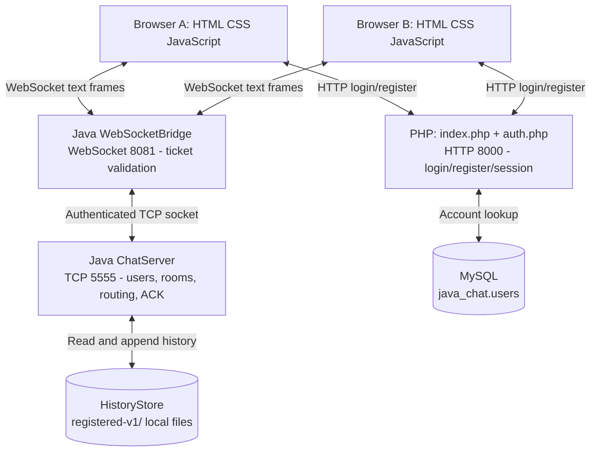
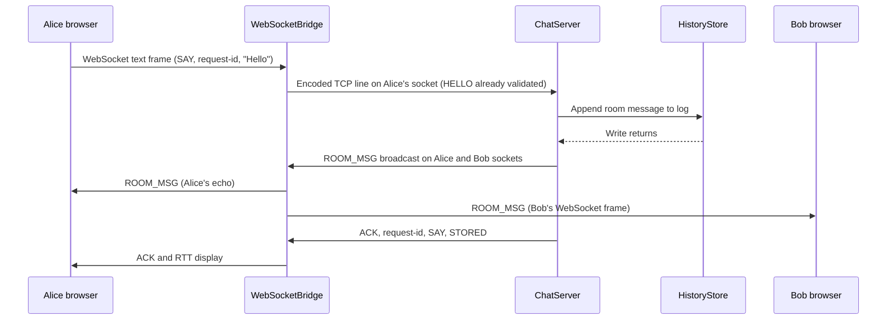
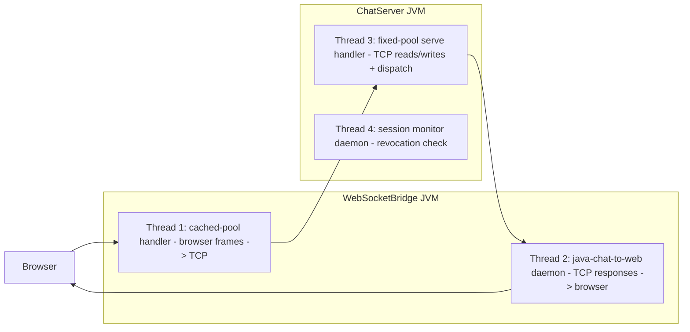

# Enhanced Java Chat System


## Features

- **Account system** — User registration and password login via PHP + MySQL
- **Multiple simultaneous users** on one Java TCP server
- **Chat rooms** — room-isolated messages, online-user list
- **Private messaging** — direct messages between online users
- **Account-scoped history** — room and DM history isolated per account with first-join membership offsets
- **Server acknowledgments** — optional request IDs with `ACK` responses for `SAY` and `DM`
- **Session revocation** — logging out closes all sockets sharing that login
- **Browser chat interface** — HTML, CSS and JavaScript
- **PHP session-based auth** + short-lived HMAC-SHA256 signed connection tickets
- **Java WebSocket bridge** — validates tickets and origin, forwards browser messages to the TCP server
- **Java integration tests** — 43 assertions covering auth, protocol, validation, concurrency, privacy, and failures

## Requirements

| Dependency | Minimum Version | Purpose |
|------------|-----------------|---------|
| JDK | 17+ | Compile and run the Java chat server and WebSocket bridge |
| PHP | 8+ | Serve the web frontend, handle auth, issue signed tickets |
| MySQL Server | 8+ | Store user accounts (registration/login) |
| Web browser | Chrome, Edge, Firefox, or equivalent | Chat client |
| Terminal | PowerShell (Windows), Bash, or Zsh | Run service startup commands |

No external Java libraries, npm packages, or Composer dependencies are required.

## Project Structure

```text
java-chat-web/
├── src/
│   ├── ChatServer.java           # Multithreaded TCP chat server (port 5555)
│   ├── WebSocketBridge.java      # WebSocket-to-TCP bridge (port 8081)
│   ├── Protocol.java             # Base64/TAB message encoding and decoding
│   ├── HistoryStore.java         # Account-scoped room and DM persistence
│   ├── AuthTickets.java          # HMAC-SHA256 ticket validation (shared)
│   └── ChatIntegrationTest.java  # Automated integration tests (43 assertions)
├── web/
│   ├── index.php                 # Login/register UI + handlers
│   ├── auth.php                  # Session lifecycle (create, validate, revoke)
│   ├── database.php              # PDO MySQL connection
│   ├── schema.sql                # MySQL users table schema
│   ├── assets/
│   │   ├── style.css             # Browser styles
│   │   └── chat.js               # Browser client logic
│   └── ...
├── data/
│   ├── registered-sessions/      # Session token files (created at startup)
│   └── registered-v1/            # Account-scoped chat history files
├── out/                          # Compiled Java class output (gitignored)
├── .gitignore                    # Git ignore rules
└── README.md                     # This file
```

## Installation

### 1. Clone the repository

```bash
git clone https://github.com/<your-org>/java-chat-web.git
cd java-chat-web
```

### 2. Install dependencies

**JDK 17+** (Windows, macOS, or Linux):

- Download from [Adoptium](https://adoptium.net/) or your platform's package manager
- Verify: `java -version` and `javac -version`

**PHP 8+**:

- Windows: [PHP for Windows](https://windows.php.net/download/) — add `php.exe` to PATH
- macOS: `brew install php@8.2`
- Linux (Debian/Ubuntu): `sudo apt-get install php8.2-cli`

**MySQL Server 8+**:

- Install MySQL and start the service
- Verify: `mysql --version`

**Web browser**: Chrome, Edge, Firefox, or equivalent.

### 3. Set up the MySQL database

Create the database, table, and application user:

```sql
CREATE DATABASE IF NOT EXISTS java_chat CHARACTER SET utf8mb4 COLLATE utf8mb4_unicode_ci;

CREATE TABLE IF NOT EXISTS users (
    account_id CHAR(32) NOT NULL PRIMARY KEY,
    username VARCHAR(20) NOT NULL UNIQUE,
    password_hash VARCHAR(255) NOT NULL,
    created_at TIMESTAMP DEFAULT CURRENT_TIMESTAMP
) ENGINE=InnoDB;

CREATE USER 'java_chat_app'@'127.0.0.1' IDENTIFIED BY '<strong-password>';
GRANT SELECT, INSERT ON java_chat.users TO 'java_chat_app'@'127.0.0.1';
FLUSH PRIVILEGES;
```

Or run the provided schema:

```powershell
"C:\Program Files\MySQL\MySQL Server 8.0\bin\mysql.exe" -u root -p < schema.sql
```

### 4. Compile the Java sources

From the repository root:

```powershell
javac -encoding UTF-8 -d out (Get-ChildItem .\src\*.java).FullName
```

Equivalent Bash:

```bash
javac -encoding UTF-8 -d out src/*.java
```

Compiled classes are written to the `out/` directory.

## Configuration

All configuration is via environment variables. Set these **in every terminal** before starting services:

| Variable | Required | Default | Description |
|----------|----------|---------|-------------|
| `CHAT_WEB_SECRET` | Yes | *(none)* | Shared secret (32+ characters) used by PHP and Java to validate signed tickets |
| `CHAT_DB_DSN` | No | `mysql:host=127.0.0.1;port=3306;dbname=java_chat;charset=utf8mb4` | PDO MySQL connection string |
| `CHAT_DB_USER` | No | *(none)* | MySQL username |
| `CHAT_DB_PASSWORD` | No | *(none)* | MySQL password |
| `CHAT_SESSION_DIR` | No | `data/registered-sessions` | Directory for session token files |
| `CHAT_WS_PORT` | No | `8081` | WebSocket bridge port |
| `CHAT_TCP_PORT` | No | `5555` | Java chat TCP server port |
| `CHAT_WEB_ORIGIN` | No | `http://127.0.0.1:8000` | Expected browser `Origin` header |

Generate a secret:

```powershell
$secret = [guid]::NewGuid().ToString('N') + [guid]::NewGuid().ToString('N')
```

**Never commit `CHAT_WEB_SECRET` or MySQL credentials to version control.**

### 5. Create the session directory

```powershell
New-Item -ItemType Directory -Force "data/registered-sessions" | Out-Null
```

## Quick Start

Open **three terminals** in the repository root. Use the same `CHAT_WEB_SECRET` in all three.

### Terminal 1 — Java chat server

```powershell
$env:CHAT_WEB_SECRET = '<your-shared-secret>'
java -cp out ChatServer
```

### Terminal 2 — Java WebSocket bridge

```powershell
$env:CHAT_WEB_SECRET = '<your-shared-secret>'
java -cp out WebSocketBridge
```

### Terminal 3 — PHP web server

```powershell
$env:CHAT_WEB_SECRET = '<your-shared-secret>'
$env:CHAT_DB_DSN = 'mysql:host=127.0.0.1;port=3306;dbname=java_chat;charset=utf8mb4'
$env:CHAT_DB_USER = 'java_chat_app'
$env:CHAT_DB_PASSWORD = '<your-mysql-password>'
php -S 127.0.0.1:8000 -t web
```

### Open the application

Navigate to **http://127.0.0.1:8000** in your browser. Use `127.0.0.1` exactly (not `localhost`) because the bridge validates the `Origin` header.

Register a new account, then log in. You will enter the chat lobby.

### Multiple users on one computer

- User 1: normal browser window as `Alice`
- User 2: Incognito/InPrivate window as `Bob`
- User 3: separate browser profile or different browser as `Charlie`

Tabs in the same browser profile usually share the same PHP session and username. Logging out in one tab revokes the session for all tabs sharing that login.

## How to Use the Website

1. Register a unique username and password (6–72 bytes), or log in with your existing account.
2. Click the `+` button next to **Rooms** to join or create a room, such as `project`.
3. Type a message and click **Send** (or press Enter).
4. Click a user under **Online users** to start a private conversation.
5. Click **Room chat** to return to the shared room.
6. Click **Load history** to view messages after your first join to that room.
7. Click **Open DM history** and enter a username to view your own private history.
8. Watch server acknowledgments and response timings appear in the UI.
9. Click **Log out** to revoke the current login and disconnect all sockets sharing it.

## How Classmates Can Test Independently

Every classmate can extract the same project and start all three services on their own computer. They can open two or three separate browser sessions to test the full application without connecting to your PC.

For shared local testing, PHP and the WebSocket bridge are intentionally limited to `127.0.0.1` and are not accessible from other computers. The TCP server also binds only to loopback. To run one shared remote website, you must first implement and deploy HTTPS, WSS, stronger authentication, a production PHP server, and a secure reverse proxy. **Do not open ports 5555, 8081, or 8000 directly to the internet.**

## Run the Automated Tests

After compiling, open a fourth terminal in the same folder:

```powershell
java -cp out ChatIntegrationTest
```

The test suite starts a temporary Java chat server on a separate port; it does not need the manually started server. The suite is designed to produce `PASS: 43 integration assertions`; verify the actual result on your machine rather than assuming it passed.

### Suggested Class Demo Checklist

- [ ] Register Alice, Bob, and Charlie from separate browser sessions
- [ ] Show duplicate registration is rejected and wrong password cannot log in
- [ ] Create a `project` room; verify lobby users do not get its messages
- [ ] Send a private message
- [ ] Log out and verify all sockets sharing that login disconnect
- [ ] Register a new account after messages have been sent; verify older messages are hidden
- [ ] Log back in as a returning account; verify eligible history is restored
- [ ] Send messages from two users simultaneously
- [ ] Disconnect a client and show the server remains running
- [ ] Explain TCP newline framing, Base64 fields, multithreading, WebSocket bridge, acknowledgments, and HMAC ticket validation
- [ ] Run integration tests and record real results

## System Architecture

The application separates the presentation layer (PHP), real-time gateway (Java WebSocket bridge), TCP messaging service (Java ChatServer), and persistent storage (MySQL for accounts, local files for chat history). PHP is not in the live-message relay path.



### Component Responsibilities

| Component | Implementation | Responsibility |
|-----------|---------------|----------------|
| Browser | `web/assets/chat.js`, `web/assets/style.css`, `web/index.php` | Renders the chat UI, opens the WebSocket, encodes/decodes protocol fields, tracks acknowledgment RTT, and displays rooms, users and messages. |
| PHP | `web/index.php`, `web/auth.php` | Registration, password login, PHP session, CSRF protection, HMAC-SHA256 signed tickets (account ID, name, session token, timestamp). |
| Database | `web/database.php`, `schema.sql` | PDO MySQL connection; stores account IDs, usernames, password hashes. |
| WebSocket bridge | `src/WebSocketBridge.java` | Validates HTTP `Origin` and ticket signature; opens one TCP connection to ChatServer per browser user; relays frames bidirectionally. |
| TCP server | `src/ChatServer.java` | Authenticates 6-field HELLO via AuthTickets; manages online users and room membership; routes commands; session revocation monitor (1-second check); account-scoped history. |
| Auth tickets | `src/AuthTickets.java` | Shared HMAC-SHA256 ticket signing and verification; session file validation. |
| Protocol | `src/Protocol.java` | Encodes each UTF-8 field separately in Base64, joins fields with TAB, terminates frames with LF. |
| Storage | `src/HistoryStore.java` | Account-scoped room/DM history files under `registered-v1/`; membership offsets at first join; serialized file access. |

### Message Flow (room message)



The server validates the message (up to 2,000 Java string characters) and enforces a 16,384-byte inbound TCP frame limit. The bridge limits WebSocket payloads to 16,384 bytes and supports unfragmented text frames. TCP segmentation is independent of WebSocket fragmentation: the TCP reader assembles bytes until a newline. The ACK follows storage and attempted routing; it is not proof of recipient display or disk fsync durability. Private messages follow the same pattern but target a named online user. Disconnections close sockets and remove registered users from shared state.

## Concurrency Model: Thread-Per-Direction Blocking I/O

### Thread Diagram



For each active web client, approximately three Java platform threads are occupied across the two JVMs:

1. **Bridge handler thread** (cached pool) — reads WebSocket text frames from the browser and forwards them to the backend TCP socket.
2. **Bridge relay thread** (`java-chat-to-web` daemon) — reads lines from the backend TCP socket and writes WebSocket text frames back to the browser.
3. **Server handler thread** (fixed pool) — reads TCP frames, dispatches commands, updates shared state, and writes responses.

A fourth **session monitor thread** checks all sessions every second and closes any whose login session has been revoked or expired.

Shared room/user state uses thread-safe collections (`ConcurrentHashMap`, `CopyOnWriteArraySet`). Writes are coordinated per-session. `HistoryStore` serializes all file access.

For N successfully connected web clients, approximately **3N client-specific threads** are occupied across the two JVMs. This excludes accept loops, JVM housekeeping and PHP.

| Active web clients | Estimated client-specific threads |
| -----------------: | --------------------------------: |
|                  3 |                                 9 |
|                 10 |                                30 |
|                 25 |                                75 |
|                 50 |                               150 |
|                100 |                               300 |
|                500 |                             1,500 |

## Blocking I/O versus Java NIO: Trade-offs

| Dimension | Current blocking sockets | Alternative Java NIO (`Selector`/`SocketChannel`) |
|-----------|-------------------------|---------------------------------------------------|
| **Scalability** | Thread count grows linearly with connections. The server uses a configurable fixed worker pool (`chat.maxClients`, default 128); the bridge uses a cached pool. | A small number of selector/event-loop threads can multiplex thousands of channels. |
| **Resource consumption** | Each thread carries a stack (~1 MB), scheduling overhead, and socket buffers. Idle reads sleep without consuming CPU. | Fewer platform threads, but per-connection state (selection keys, buffers, output queues) still consumes memory. |
| **Performance** | Simple and predictable for small groups. Blocking writes and synchronized file I/O can stall a worker. | Fewer context switches at high concurrency; not automatically faster at small scale. |
| **Implementation complexity** | Sequential read/write code; straightforward lifecycle and debugging. | Explicit connection state machines, partial read/write handling, interest operations, bounded queues. |
| **Failure handling** | Exceptions and `finally` blocks close sockets; blocking writes can stall a worker. | Readiness events drive state transitions; slow clients require backpressure and queue limits. |

## Design Decision

We retain blocking I/O for this classroom prototype because it is easier to understand, implement, debug and demonstrate with a small group of users. It makes the two relay directions and TCP request handling explicit. We accept the linear thread cost and recognize that synchronized file I/O and blocking writes can limit performance. If measured workload exceeds the intended scope, we would first introduce connection limits and backpressure, then evaluate a selector-based architecture.

## Security Limitations

This is a **local classroom prototype**, not a production authentication service. The site uses local HTTP and WebSocket transport without TLS. Passwords are hashed in MySQL, but tickets and session files are not encrypted in transit over localhost. Do not expose ports 5555, 8081, or 8000 directly to the internet. Hosting for remote users needs HTTPS/WSS, real sign-in, access controls, and production hardening.

## Troubleshooting

| Problem | Fix |
|---------|-----|
| `javac` invalid filename error | Run the PowerShell `Get-ChildItem` compilation command from the folder containing `src`. |
| `java` or `javac` not recognized | Install JDK 17+ and reopen PowerShell. |
| `php` not recognized | Install PHP 8+ and make `php.exe` available on PATH, or use its actual full path. |
| `mysql` not recognized | Use the full path, e.g. `C:\Program Files\MySQL\MySQL Server 8.0\bin\mysql.exe`. |
| PHP extension startup warnings | Run `php --ini` and correct `extension_dir`; ensure `extension=pdo_mysql` is enabled. |
| Website shows `CHAT_WEB_SECRET` missing | Set the secret **before** starting PHP, and use the same value for the Java bridge. |
| Website shows `Account service unavailable` | Verify `CHAT_DB_DSN`, `CHAT_DB_USER`, `CHAT_DB_PASSWORD` are set and MySQL is running. Verify `data/registered-sessions/` exists and is writable by PHP. |
| Browser cannot connect | Verify all three services are running and use `http://127.0.0.1:8000`. |
| WebSocket 403 | Check matching secrets, exact origin (`http://127.0.0.1:8000`), and refresh the page for a fresh ticket. |
| Username already online | Use a different name or close the other session and allow its socket to disconnect. |
| Port already in use | Stop the previous Java/PHP process or change the relevant port and matching settings. |
| Revoked login does not disconnect | The session monitor checks every second; wait up to 1 second after logout. |
